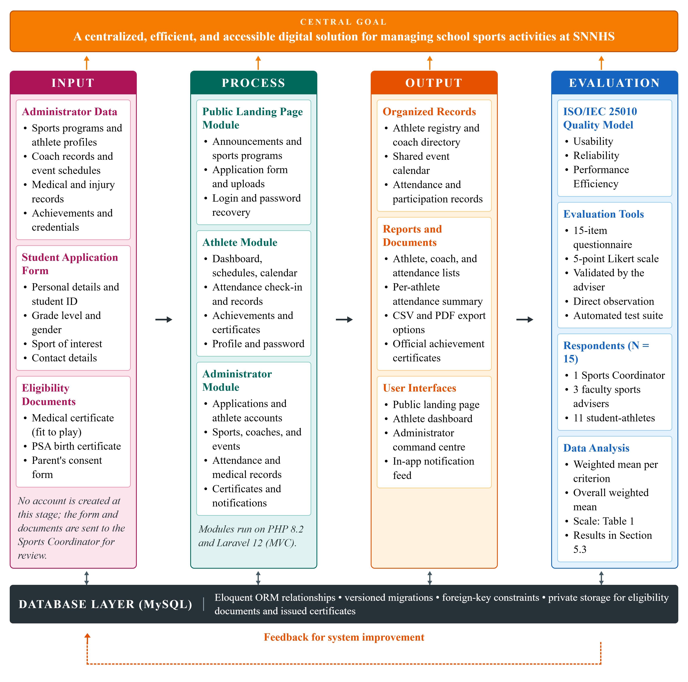

# SportsHub: A Progressive Web Application for Athlete Records and Sports Activity Management System

**Capstone Project Presented to**
**The Faculty of the College of Computing & Information Sciences**
**Surigao del Norte State University**
**Surigao City**

**In Partial Fulfillment**
**Of the Requirements for the Degree**
**Bachelor of Science in Information Technology**

**By**

Jocel C. Cagabcab
Alexamie L. Ochavo

May 2026

---

## TITLE OF THE STUDY

SportsHub: A Progressive Web Application for Athlete Records and Sports Activity Management System

---

## ABSTRACT

This study aims to design and implement SportsHub, a Progressive Web Application (PWA), for Surigao del Norte National High School (SNNHS). The main motivation for this project is the lack of a proper system for tracking sports activities and athlete records in the school. Right now, the school has already started organizing sports clubs, but all the records are still being managed manually. This leads to disorganized data, difficulty in monitoring athlete participation, and poor coordination of events.

The proposed system has three main parts: a public-facing landing page, an athlete dashboard, and an administrator dashboard. The landing page is where students can browse posted announcements and submit an application form to express interest in joining a sport. Announcements are published by the portal itself whenever the Sports Coordinator schedules a new event, so the public page always reflects the live schedule without a separate announcement workflow. As part of the application, students submit a medical certificate, a birth certificate, and a signed parent's consent form. No account is created at this stage; after submission the system generates a unique reference number so the applicant can securely check their status using the reference number and application email. The administrator reviews submitted applications inside the admin dashboard, verifies documents, and sets status to Pending, Under Review, Requires Revision, Approved, or Rejected, with required explanations for rejection/revision, optional office instructions, reviewer/date recording, and status history for accountability. If approved, the admin creates an official athlete account (the system prevents duplicate account creation for repeated approvals) and the athlete signs in with a generated temporary password that must be changed on first login. From the athlete dashboard, athletes can view schedules, events, announcements, attendance records, achievements, notifications, coach information, and application status/feedback, check in to open attendance sessions, request achievement certificates, and update profile details. The administrator dashboard provides full tools to manage sports programs, athlete accounts, coaches, events, calendar, attendance sessions, medical records and injury incidents, achievements, certificate requests, and reports.

The project follows a Rapid Application Development (RAD) approach covering planning, prototyping, feedback, finalization, and a formal evaluation phase. Once completed, the system is evaluated based on usability, reliability, and performance efficiency using the ISO/IEC 25010 quality standard. The developed system is backed by an automated feature test suite and is expected to improve data organization, reduce the time spent on manual recording, and make it easier for both students and administrators to access and manage sports-related information.

**KEYWORDS:** education, information system, philippines, sports management, system development

---

## 1. INTRODUCTION

The lack of a proper system for tracking sports activities and athlete records in Surigao del Norte National High School makes it difficult to manage sports programs, monitor athlete participation, and organize events. This study aims to design and develop a SportsHub for the school to make sports management more organized and easier to handle. At present, the school has already started forming sports clubs, but there is still no system in place to manage records properly. Because of this, information is often scattered, and it becomes hard to keep track of athletes and scheduled activities.

Sports programs are very important for students because they help improve physical fitness, teamwork, discipline, and leadership skills. In many schools, sports-related information like player lists, schedules, and event records are still handled manually using paper or simple spreadsheets. While this method works to some extent, it can lead to errors, repeated data, and even loss of important information. It also takes more time to update records and find needed data, especially when there are many participants involved. That is why many schools are now starting to use digital systems to make their processes faster and more efficient.

In the case of Surigao del Norte National High School, the absence of a proper sports management system affects how sports clubs and activities are organized. Without a centralized platform, administrators and coaches find it challenging to monitor participation, manage events, and keep records updated. This can lead to confusion, missing information, and poor planning of activities. Developing SportsHub can help solve these problems by giving the school a single system where all sports-related data can be stored and managed properly.

This study focuses on developing and testing SportsHub, a web-based Progressive Web Application that can handle sports records, athlete information, coach assignments, event scheduling, attendance tracking, medical clearances, achievements, and certificates. The system is expected to make data more organized, reduce manual work, and make it easier for users to access information. It can also generate CSV and PDF reports that will help in monitoring sports activities and making better decisions for future programs.

This study aims to answer the following research questions:

- What problems are currently being experienced in managing sports activities and athlete records in Surigao del Norte National High School?
- How can a web-based SportsHub improve the management of sports activities and athlete records?
- How effective is the proposed system in terms of usability, reliability, and performance efficiency?
- What improvements can be suggested for the future development of the system?

### 1.1 Project Context

This project was conceptualized in response to the lack of an organized system for managing sports activities and athlete records in Surigao del Norte National High School (SNNHS). Although the school has started forming sports clubs and conducting activities, most of the records are still handled manually or written in simple lists. Because of this, it is difficult for coaches and coordinators to keep track of athletes, monitor participation, and manage schedules properly.

The project is set within the school's sports management environment, where different activities such as trainings, intramurals, and club events are regularly conducted. These activities require proper planning and organized records to run smoothly. However, without a digital system, information can become unorganized or incomplete, making it harder to retrieve when needed. This situation affects how sports programs are planned and managed in the school.

This project is important because it supports the school's move toward using technology to improve its processes. By developing SportsHub, the school can have a centralized system where all sports-related data is stored and managed in one place. This will make it easier for administrators and coaches to access information, update records, and organize activities more efficiently.

In addition, the project can benefit the entire school community by improving how sports programs are monitored and managed. With a more organized system, records will be more accurate and easier to maintain. This system can also serve as a foundation for future improvements and possible expansion to other school systems.

### 1.2 Purpose and Description

The purpose of this project is to create SportsHub, a Progressive Web Application that will help Surigao del Norte National High School (SNNHS) organize and manage its sports activities more effectively. Since the school currently does not have a proper system for tracking sports, athletes, and events, this project aims to provide a simple and organized digital solution that can replace manual recording.

The system is made up of three main parts. The first is a public-facing landing page that any student can access without logging in. On this page, the school’s Sports Coordinator can publish announcements such as recruitment drives, tryout schedules, and upcoming events. These announcements are produced by the portal itself: as soon as an event is created and scheduled, SportsHub automatically publishes a matching announcement on the landing page, and the announcement is automatically withdrawn if that event is later cancelled or postponed. This removes the risk of a public notice contradicting the live schedule. Students who are interested in joining a sport can fill out and submit an application form directly from this page. To ensure eligibility, the application requires the submission of a medical certificate, a birth certificate, and a signed parent’s or guardian’s consent form. No account is created at this point — the form simply sends the student’s information and documents to the admin for review.

Student eligibility is verified through documentary requirements submitted alongside the application form. A student must provide a valid medical certificate issued by a licensed physician confirming that they are physically fit to participate in sports activities, a birth certificate issued by the Philippine Statistics Authority (PSA) to confirm age and identity, and a duly signed parent’s or guardian’s consent form authorizing the student’s participation in school sports programs. Applications that are incomplete or missing any of these documents will not be processed for approval. These requirements are intended to protect the health and safety of student-athletes and ensure that all participants meet the school’s standards for sports participation.

The second part is the administrator dashboard, which is accessible only to the Sports Coordinator or authorized Admin. After a student submits an application, the system generates a unique reference number and records the application as Pending. The admin can view all applicants inside the dashboard and move each one through a structured review workflow: Pending, Under Review, Requires Revision, Approved, or Rejected. The workflow records the state of each uploaded document separately as Submitted, Verified, or Rejected. When requesting a revision or rejecting an application, the coordinator provides a required explanation; the coordinator may also add office instructions (for example, to visit the SNNHS Sports Office). The system records the reviewer, decision date/time, and status history for accountability. Applicants can securely check their status on the public status page using their reference number and application email, and linked student accounts receive in-app notifications without sensitive details in previews. If a student is approved, the admin creates an official athlete account and the system prevents duplicate account creation for repeated approvals.

The third part is the athlete dashboard, which is the personal space for officially registered athletes. From here, athletes can view their schedules, upcoming sports events, posted announcements, a shared calendar, their attendance records, their achievements, and their coach’s information. They can check in to attendance sessions that are open on the current day, request an official certificate for an achievement they have earned, review the status and feedback of their application, and update profile details such as their contact number, emergency contact, and profile photo. Since the admin controls account creation, only verified and approved athletes can access this dashboard, making the system more secure and easier to manage.

Overall, the project is designed to make sports management in the school more organized, secure, and efficient for both athletes and administrators. It also serves as a starting point or foundation that can be improved and expanded in the future if needed.

### 1.3 General Objectives of the Study

This study aims to design and implement a web-based SportsHub for Surigao del Norte National High School to improve the management and organization of sports activities.

Specifically, it aims to:

- Gather data on the current sports management practices and challenges at Surigao del Norte National High School (SNNHS) through informal observation and the researchers’ personal experience as former student-athletes, in order to identify the functional requirements of the proposed SportsHub.
- Design and develop a web-based Progressive Web Application (SportsHub) that provides a centralized platform for managing athlete records, sports programs, coach assignments, event scheduling, attendance monitoring, medical records, achievements and certificates, and announcements at SNNHS using PHP 8.2, Laravel 12, MySQL, and Tailwind CSS 4.
- Test and evaluate the developed system using the ISO/IEC 25010 Software Quality Model in terms of usability, reliability, and performance efficiency among selected SNNHS respondents, and provide recommendations for future system improvement based on the evaluation results.

### 1.4 Scope and Limitations

**Scope**

- The system covers three main user interfaces: a public-facing landing page, an athlete dashboard, and a restricted administrator dashboard accessible only to the Sports Coordinator.
- The landing page allows any student to view announcements, browse the available sports programs, and submit a sports application form. To be eligible to join a sport, students must submit a medical certificate, a birth certificate, and a signed parent’s or guardian’s consent form as part of their application. No account is created at this stage. Announcements are published automatically by the portal when a scheduled event is created, and are withdrawn automatically when that event is cancelled or postponed.
- The administrator can review applications and set status to Pending, Under Review, Requires Revision, Approved, or Rejected; verify or reject each uploaded document; require explanations for rejection or revision; add office instructions; and record reviewer identity, decision date/time, and status history. Applicants can securely check status with their reference number and email, and linked students receive in-app status notifications.
- Approved applicants are converted into official athlete accounts with an assigned sport, a username, and a one-time temporary password that the athlete must replace on first login.
- Registered athletes can log in to view their schedules, events, calendar, announcements, attendance records, achievements, application status, coach information, notifications, and the members of their own sports program, and can update profile details, check in to open attendance sessions, and request achievement certificates.
- The administrator dashboard manages sports programs, athlete accounts, coach assignments, event schedules, attendance sessions, medical records and injury incidents, achievements, certificate requests, and downloadable reports.
- The administrator can choose the scope of a downloaded athlete list — either the whole school or a single sport program — and can export the athlete, coach, attendance, and per-athlete attendance reports in CSV or PDF format.
- Attendance is tracked through attendance sessions that may belong to a scheduled event or stand alone. The roster of each session is derived automatically from the athletes assigned to the session’s sport, so no manual roster selection is required. A configurable late grace period separates a Present check-in from a Late one, and cancelled sessions are excluded from attendance-rate calculations.
- Medical records track examination results, clearance status, uploaded medical certificates with expiry monitoring, and scheduled check-ups. Injury incidents are recorded separately per athlete with severity, treatment, rest period, return-to-play date, and medical clearance, so that a new examination never overwrites an injury history.
- The system is delivered as an installable Progressive Web Application with a web app manifest and a service worker that caches the application shell and falls back to a dedicated offline page when the network is unavailable.
- The system will be evaluated using the ISO/IEC 25010 quality standard covering usability, reliability, and performance efficiency, with fifteen (15) respondents from SNNHS including the Sports Coordinator, faculty sports advisers, and student-athletes.

**Limitations**

- The system does not include financial management, student grading features, or integration with any external platforms such as a Learning Management System (LMS) or other school information systems.
- A dedicated native application for Android or iOS is not part of this study. As a Progressive Web Application (PWA), the system is accessible through any standard web browser on any device, including smartphones, tablets, and laptops, without requiring additional software installation.
- The evaluation will be conducted exclusively at SNNHS, and the results may not be generalizable to schools with different operational contexts, infrastructure, or resource availability.
- The accuracy of athlete records depends entirely on the administrator who manually inputs data; the system has no automated data validation against external school databases.
- The offline capability is a caching convenience rather than a full offline mode. Read-only screens remain browsable from the cache when the connection drops, but server-backed operations — submitting an application, checking in to a session, or approving a document — still require an active internet connection. Credentials and records are never stored on the device.

---

## 2. RELATED LITERATURE

### Foreign Literature

Hao et al. (2024) designed a web-based college sports events management information system integrating event release, registration, race scheduling, and performance management using front-end and back-end separation architecture with Ajax and RESTful API technology. The system resulted in fast data transmission and significantly improved user satisfaction. However, the system targets higher education institutions and does not address implementation needs of secondary-level schools with limited technical infrastructure in developing countries like the Philippines. This gap underscores the need for a more accessible, school-level sports activity management system such as the one proposed for SNNHS.

Ma et al. (2024) developed a college student sports performance management system demonstrating that digitized sports records significantly reduced manual workload and improved data accuracy. Nevertheless, the study was confined to higher education, and no equivalent pilot system has been developed for senior high school sports programs. This gap calls for a comparable but simplified digital system tailored for secondary schools like SNNHS.

Sun (2020) presented a school sports management system based on web technology that automated attendance, sports data recording, and physical education management, significantly reducing administrative burden and improving record accuracy. Despite these contributions, the study did not address the integration of student registration, intramural scheduling, and real-time results tracking in a unified hub — core functions needed in a comprehensive school sports activity system.

Wang and Park (2021) developed an intelligent sports training management system for college students using deep learning and Browser/Server architecture. Results showed that 64% of students increased their weekly exercise frequency. However, the complexity and cost of AI-driven systems present challenges for implementation in resource-limited secondary schools. The current study addresses this gap by proposing a simpler, cost-effective web-based system appropriate for a public senior high school.

Zhang et al. (2021) proposed an optimized sports event management system integrating registration, scheduling, score recording, and report generation in a single platform for improved coordination efficiency. Nonetheless, the study focused on professional sporting events and did not consider operational constraints of school-level intramural sports management. The proposed SNNHS system fills this void by addressing the specific logistical and resource realities of a public secondary school.

Zhu (2025) introduced an Intelligent Sports Management System integrating wireless sensor networks and neural networks for real-time monitoring, injury prediction, and administrative reporting. However, the system requires advanced IoT hardware and high-speed network connectivity, making it impractical for deployment in public high schools with constrained infrastructure.

Jastrow et al. (2022) conducted a systematic review of digital technology use in physical education from 2009 to 2020, finding that digital media served as effective motivational tools. The review identified a significant gap in research on digital tools specifically designed for after-school and extracurricular sports management — an area directly addressed by the proposed SportsHub at SNNHS.

Zhong et al. (2025) conducted a comprehensive systematic review on digital-intelligent technologies in physical education, finding that 86% of digital implementations occurred in formal PE classes while after-school sports activity applications accounted for only 5% of cases. This directly points to the need for systems like the SportsHub that support organized extracurricular sports participation at the secondary school level.

Martín-Rodríguez and Madrigal-Cerezo (2025) reviewed technology-enhanced pedagogy in physical education and emphasized that successful digital implementation requires alignment with educational objectives. A key gap identified was the lack of research on simple, low-cost digital platforms suitable for sports activity management in secondary schools — a gap the current study seeks to fill.

Li et al. (2022) proposed an IoT-assisted physical activity monitoring system demonstrating improvements in student physical activity outcomes. However, high costs of IoT infrastructure pose barriers to adoption in public secondary schools. The proposed SNNHS system circumvents this barrier by relying exclusively on web-based, device-agnostic technology requiring no additional hardware.

Xu et al. (2024) found that user readiness is as critical as the technology itself in digital sports tool adoption, suggesting that culturally responsive design matters greatly. This study addresses the gap by designing a user-friendly, culturally responsive system suited to Filipino senior high school students.

Sang and Wang (2022) demonstrated high data integrity in a fitness monitoring system using IoT and blockchain technology. No comparable system exists for secondary school populations in the Philippine context, reinforcing the urgency of developing even a foundational digital system for SNNHS.

Haffner et al. (2025) identified that most sports digitalization studies focus on single-stakeholder effects, calling for ecosystem-level research. This justifies developing a hub-based system that addresses multiple user roles. The proposed system is explicitly designed to serve students, coaches, coordinators, and administrators simultaneously.

Qi et al. (2024) cautioned that over-reliance on automated systems without adequate human oversight could diminish coaching expertise. This finding highlights the importance of designing sport hubs that augment rather than replace the roles of teachers and sports coordinators — a guiding principle in the design of the SNNHS system.

Swim et al. (2023) argued that digital literacy is a core competency in sport management education, supporting the integration of a SportsHub at SNNHS where students gain early exposure to digital sports management systems.

### Local Literature

The Department of Education (2023) issued Memorandum No. 005, s. 2023, known as the "Sports for All" policy, which mandates all DepEd schools to conduct organized sports competitions and maintain comprehensive documentation of student sports participation. However, most schools, including SNNHS, currently rely on manual and paper-based processes that make compliance monitoring difficult. The proposed SportsHub directly addresses this compliance gap by automating documentation and sports record-keeping.

The Department of Education (2024) introduced a Sports Activity Management course under the Strengthened Senior High School Curriculum. A functional digital SportsHub at SNNHS would directly support the documentation, scheduling, and evaluation components required by this curriculum, enhancing learners’ practical engagement with the subject.

Cagas et al. (2022) reported in the 2022 Philippine Report Card on Physical Activity that 84.5% of Filipino adolescents fail to meet the recommended 60 minutes of daily physical activity. A centralized SportsHub at the school level would provide a structured platform to increase sports participation and monitor student activity engagement at SNNHS.

The Philippine Sports Commission (2023) emphasized that schools serve as primary venues for talent identification and physical fitness promotion. Local studies confirm that school-level sports programs lack digital tools to track, document, and report sports participation systematically. This gap in school-level digital infrastructure motivates the development of the proposed SNNHS SportsHub.

Cullarin-Bernales (2021) found significant challenges in coordinating and administering school sports programs and recommended a prototype sports management framework. However, the prototype did not incorporate digital tools, leaving a gap in automated data management. The SNNHS system fills this gap by providing a fully digital, web-based management solution.

Pestano and Ibarra (2021) highlighted the critical need for organized monitoring tools and documented tracking of student-athlete performance across competition levels — needs that the proposed SportsHub is specifically designed to address.

Cipriano et al. (2024) recommended digital administrative tools to support sports program governance and monitoring in educational institutions. This recommendation validates the core purpose of the SNNHS SportsHub as a governance and monitoring tool.

Butlig et al. (2023) recommended structured institutional systems for managing student-athlete schedules and academic monitoring — functions that the proposed hub integrates into a single digital platform.

Campo et al. (2024) identified that digital tools specifically for physical sports activity management and extracurricular sports coordination remain underdeveloped in the Philippine context, providing strong justification for developing the SNNHS SportsHub as a locally responsive digital solution.

Galindo et al. (2024) recommended comprehensive strategies including better scheduling and monitoring systems to help student-athletes balance their dual roles. This recommendation aligns directly with the scheduling and monitoring functions built into the proposed SNNHS system.

Umali (2025) recommended that schools institutionalize organized sports programs supported by clear administrative and documentation frameworks to sustain the developmental benefits of school sports. The proposed hub operationalizes this recommendation through a structured, digitally supported sports management environment.

---

## 3. TECHNICAL BACKGROUND

The SportsHub is a web-based information system that will be used to coordinate sports activities, athlete records, coach assignments, event scheduling, attendance, medical clearances, achievements, and certificates at Surigao del Norte National High School (SNNHS). The system is developed using widely used and well-supported web technologies that are appropriate for an educational development project.

**Frontend Technologies.** The user interface is built using HTML5, CSS3, and JavaScript, which are the current standards in web development. HTML5 is used to create the structure of the pages, CSS3 handles the visual layout and styling, and JavaScript manages client-side interactions. The styling approach combines **Tailwind CSS 4**, compiled through the Vite 7 build pipeline, with a **hand-authored design system** published as static assets in `public/css/`. The design system is defined through a single set of CSS custom properties in `theme.css` — covering the school primary colour, the accent orange, neutral surfaces, and semantic status colours for present, late, absent, excused, and pending — and consumed by `portal.css`, `landing.css`, and `sportshub.css`. This token-based approach gives both portals and the public landing page one consistent visual language, and it supports a light and dark theme that the user can switch and that the system remembers between visits. Reusable interface components such as the confirmation dialog, the password-reset modal, the avatar, the notification bell, and the collapsible sidebar are implemented as shared partials and scripts rather than repeated markup, so that behaviour stays consistent across every module.

**Backend Technologies.** The server-side logic of the application is written in PHP 8.2, a popular scripting language that is well-suited for web-based applications in school or institutional settings. PHP handles user requests, processes form submissions, validates uploaded documents, and communicates with the database. **Laravel 12** is used alongside PHP to follow an MVC (Model–View–Controller) structure that separates the user interface from the database operations. Laravel's service container is used to keep cross-cutting logic out of the controllers — the attendance session service owns roster generation and check-in rules, the certificate service owns the single official certificate layout, the notification service owns targeted fan-out, and the security service owns failed-password warnings. Blade templates handle the view layer, Laravel's validation and authentication features handle input safety, and database notifications give every portal an in-app notification feed. This division of responsibility makes the system easier to develop, manage, and maintain.

**Database Management.** MySQL is the relational database management system (RDBMS) that stores and manages all system data, including sports programs, athlete profiles, coach records, event schedules, attendance sessions, medical records, achievements, and certificate requests. It is a good fit for this project because of its strong compatibility with PHP and Laravel, and its support for structured queries like filtering, searching, and generating reports. The schema is created and versioned through Laravel migrations, and the data is accessed through the Eloquent ORM, which expresses the relationships between entities — a sport has many athletes, coaches, and events; an event has many attendance records; an athlete has many achievements — as declarative model associations backed by foreign key constraints.

**Document and Report Output.** Official documents are generated server-side rather than through the browser's print dialog. The **dompdf** library renders achievement certificates, attendance session reports, and school reports directly into PDF files, and the same report payloads are streamed as CSV when a spreadsheet format is requested. This guarantees that a downloaded certificate is identical for every recipient and carries an official reference number, and it lets the coordinator export a filtered roster for documentation without leaving the portal.

**Progressive Web Application Support.** SportsHub is delivered as a Progressive Web Application so that it can be installed on a phone or desktop and still open quickly on a weak connection. The application ships a web app manifest that defines the application name, theme colour, display mode, and icon, together with a hand-written service worker. The service worker precaches the application shell, serves navigation requests network-first, stores successful responses in a runtime cache, and falls back to a dedicated offline page when the network is unavailable. A lightweight registration script loads the worker without blocking the page.

**Development Environment.** The system is developed and tested locally using XAMPP as the local server environment on a Windows machine, with MySQL as the database server and the application served through Apache. Visual Studio Code is used as the primary code editor, and Git is used for source code versioning, allowing the development team to track changes, manage revisions, and maintain a stable codebase. The application is configured for the Philippine Standard Time zone so that all recorded timestamps — session dates, check-in times, publication dates, and medical check-up schedules — are interpreted consistently for the school's own calendar.

### 3.1 Conceptual Framework

The SportsHub is guided by the Input–Process–Output–Evaluation (IPO-E) model, which shows how raw data entered into the system will be transformed through a series of operations into organized outputs that support sports management at SNNHS, and then assessed through a formal evaluation phase. As shown in Figure 1, the framework is made up of four main components: Input, Process, Output, and Evaluation, all supported by the system's technology stack and directed toward the central goal of the project. A feedback loop runs from the Evaluation component back to the Input and Process components, so that the weighted-mean results and observational findings are used to identify the specific records, operations, and quality attributes that require improvement in the next iteration of the system.

**Figure 1. Conceptual Framework (IPO-E Model) — SportsHub, SNNHS**

The **Input** component consists of all data that will be provided by the Administrator or Sports Coordinator, together with the data and documents submitted by the public. This includes sports program details, student-athlete profiles, coach information, event schedules, medical examination findings, injury incident reports, achievement records, and login credentials. From the public side, the input consists of the sports application form and its three supporting documents - a medical certificate, a birth certificate, and a signed parent's or guardian's consent form - plus the applicant's email address used for secure status verification. These inputs are meant to replace the informal paper-based records currently used at SNNHS.

The **Process** component is organized into three system modules (the Public Landing Page Module, the Athlete Module, and the Administrator Module) that carry out the core operations of the system. These operations include adding, editing, deleting, and viewing records; generating a unique application reference number after submission; securely checking application status using the reference number and matching email; verifying documents; reviewing applications; marking applications as Pending, Under Review, Requires Revision, Approved, or Rejected with required explanations where applicable; recording reviewer identity, decision date/time, status history, and office instructions; creating approved athlete accounts while preventing duplicates; scheduling events; generating attendance sessions and their rosters; recording attendance and check-ins; tracking medical clearance and check-up schedules; recording achievements; approving and issuing certificates; sending in-app notifications (without exposing sensitive details in previews); searching and filtering data; and generating reports. The modules are built on PHP 8.2 and Laravel 12 (MVC) and exchange data with the Database Layer (MySQL) through the Eloquent ORM.

The **Output** component represents the results that the system will produce: an organized athlete registry, a coach directory, application records with reference numbers and status-history audit trails, a secure applicant status page, a shared event calendar, printable participation and attendance reports, official achievement certificates in PDF form, an in-app notification feed for athletes and coordinators, and an administrative command centre that gives coordinators an at-a-glance view of sports data - total athletes, active sports programs, upcoming events, sessions open for check-in, pending applications, achievements and medals recorded, and the current attendance rate.

The **Evaluation** component measures the quality of the system outputs using the ISO/IEC 25010 Software Quality Model, specifically assessing the system in terms of usability, reliability, and performance efficiency. The primary evaluation tool is a structured fifteen-item questionnaire — five items per quality characteristic — administered on a five-point Likert scale ranging from 1 (Strongly Disagree) to 5 (Strongly Agree), developed by the research team and validated by the research adviser. The questionnaire is answered by fifteen (15) SNNHS respondents: the designated Sports Coordinator, three faculty members serving as sports advisers, and eleven student-athletes representing different sports categories. In addition to the questionnaire, the evaluation includes direct observation by the development team during the testing session, and it is supported by an automated feature test suite that exercises every major module — applications, attendance, events, achievements, certificates, medical records, notifications, and the two password workflows — so that functional reliability is verified continuously alongside the user-facing survey. The quantitative data are analyzed using descriptive statistics, specifically the weighted mean for each quality characteristic and the overall weighted mean across all items, and interpreted with the verbal interpretation scale presented in Table 1 of Section 4.5. The computed scores, the observational findings, and the recommended improvements are reported in Section 5.4 of this study, and the resulting feedback is fed back to the Input and Process components for the next iteration of the system.

The system will be built using PHP 8.2 and Laravel 12 for the backend, Tailwind CSS 4 with a token-based CSS design system for the frontend interface, and MySQL for structured data storage. Together, these components will work as an integrated platform that provides SNNHS with a centralized, efficient, and accessible digital solution for managing school sports activities, replacing the disorganized manual practices that currently make it difficult for coaches and coordinators to track athlete participation and event schedules.

---

## 4. METHODOLOGY

This project followed the Rapid Application Development (RAD) methodology because of its emphasis on quick prototyping and iterative user feedback, which is well-suited for developing a web-based management system within an academic timeframe. The RAD model allowed the development team to move quickly from requirements gathering to design, receive feedback early, and make improvements before finalizing the software. This approach helps minimize development risks and keeps the project closely aligned with the real needs of Surigao del Norte National High School.

The RAD methodology was also chosen because the project scope is clearly defined and the intended users, specifically the school administrator and sports coordinator, are accessible for feedback and validation throughout the development process. The four main phases of RAD applied in this study are: (1) Planning Requirements, (2) Prototype, (3) Receive Feedback, and (4) Finalize Software, followed by system evaluation.

**Figure 2. Rapid Application Development (RAD) Model**

### 4.1 Planning Requirements

The planning phase focused on identifying the functional and non-functional requirements of the SportsHub. Instead of relying solely on formal interviews or surveys, the requirements for this project are largely based on the personal experience of the researchers as former student-athletes in a Philippine public high school setting, particularly in schools similar to SNNHS in terms of context and available resources.

As former student-athletes, the researchers have personally experienced the challenges of manually managed sports programs. Records of sports participation were often written on paper or encoded in basic spreadsheets, making it difficult to find information when needed. Coach assignments were communicated informally, and event schedules were posted on bulletin boards or shared through word-of-mouth. Athletes frequently missed or forgot upcoming events because there was no centralized notification or scheduling system in place. These real-life experiences provided a grounded and realistic basis for defining what the system needs to accomplish.

To support this experiential foundation, the researchers also conducted informal observation of the current sports management practices at SNNHS. Through these observations, it was confirmed that the school had already started organizing sports clubs but continued to rely on manual documentation. Coaches and coordinators were found to have difficulty consolidating records, tracking which athletes were active, and keeping event information up to date. These observations helped validate the requirements identified through the researchers’ personal experience and gave additional context specific to SNNHS.

Based on these inputs, the following key requirements were identified for the SportsHub:

**Functional Requirements**

*Admin / Sports Coordinator:*

- Secure login and authentication for the Administrator or Sports Coordinator, with a self-service password reset link and an automatic warning when a wrong password is entered
- View and manage student applications submitted from the landing page, moving each one through Pending, Under Review, Requires Revision, Approved, or Rejected
- Verify or reject each uploaded eligibility document individually, request revisions with required explanations, record review notes, rejection reasons, and office instructions visible on the applicant's status page, and maintain a status-history audit trail (reviewer and date/time)
- Create official athlete accounts for approved applicants (name, email, student ID, assigned sport, username, and a one-time temporary password)
- Reset an athlete’s password from the Athlete Management module and require the athlete to set a new one on first login
- Manage sports programs (Add, Edit, Delete, View) including classification, gender grouping, status, and logo
- Manage athlete profiles and account details, including contact number, emergency contact, and profile photo
- Assign coaches to specific sports, distinguishing Head Coaches from Assistant Coaches, and manage their profiles and status
- Schedule and manage sports events such as trainings, tournaments, intramurals, tryouts, and meetings
- View a shared calendar of all scheduled activities, filterable by sport, venue, event type, and status
- Record and manage athlete attendance through attendance sessions, with automatic roster generation from the assigned sport and a configurable late grace period
- Manage medical records, medical clearances, uploaded medical certificates, upcoming check-ups, and injury incidents
- Record achievements for athletes or teams, and approve, generate, release, and issue official achievement certificates
- Review and act on certificate requests submitted by athletes
- Send targeted notifications to athletes, either school-wide or limited to a specific sports program
- Search and filter all records in the dashboard
- Generate participation, attendance, coach, and athlete lists in CSV or PDF, with the option to limit an athlete list to a single sport program

*Athlete:*

- Log in using credentials provided by the admin, and set a personal password on first login
- View personal athlete dashboard with attendance summary, open check-in sessions, upcoming activities, and recent achievements
- View sports schedules and upcoming events
- View the shared calendar and posted announcements
- View personal attendance records and attendance rate
- Check in to an attendance session that is open on the current day
- View personal achievements and request an official certificate for an achievement earned
- View the status, reference details, feedback, and office instructions of the linked sports application, and receive in-app notifications when the status changes
- View assigned coach information and the members of the assigned sports program
- Update limited profile information and change the account password

*Public (No Login Required):*

- View the public landing page and browse posted announcements and available sports programs
- Submit a sports application form to express interest in joining a sport, including the required eligibility documents: a medical certificate, a birth certificate, and a signed parent’s or guardian’s consent form (no account created at this stage)
- Eligibility requirements for joining a sport: (1) Medical Certificate — issued by a licensed physician certifying the student is physically fit for sports participation; (2) Birth Certificate — PSA-issued document confirming the student’s age and identity; (3) Parent’s or Guardian’s Consent Form — a signed document authorizing the student to participate in school sports activities. Incomplete submissions were not processed.

**Non-Functional Requirements:**

- Usability: The interface must be simple and intuitive for non-technical users such as coaches and school administrators, with a consistent sidebar navigation and a light or dark theme
- Reliability: The system must consistently perform operations without data loss or error, verified through an automated feature test suite
- Performance Efficiency: Pages and operations must load within acceptable response times under a normal internet connection, with each dashboard figure resolved by a single aggregate query rather than repeated per card
- Security: Data must be accessible only to authorized users through login authentication; athlete-facing queries are scoped to the signed-in account so that one athlete can never read or act on another’s records
- Privacy: Eligibility documents, medical certificates, and issued certificates are stored on private storage and are released only through authorized routes
- Accessibility: The system must be accessible via standard desktop or laptop browsers without requiring additional software installation, and must remain readable on smaller screens
- Offline tolerance: Previously loaded screens must remain browsable through the service-worker cache when the connection drops, with a clear offline page as the final fallback

These requirements served as the foundation for the system's design and development, making sure that the SportsHub addresses the real and observed needs of SNNHS rather than generalized assumptions.

### 4.2 Prototype

After identifying the system requirements, a low-fidelity prototype was developed to visualize the layout and workflow of the SportsHub before actual coding began. The prototype was created using Figma, a widely used interface design tool that allows for quick creation of wireframes and mockup screens. The main goal of this phase was to establish a shared visual understanding of the system among the development team and to present an early preview to the target users for initial feedback.

The prototype covered all major modules of the system and followed a clean and minimal design approach to ensure ease of navigation, especially for school administrators and coaches who may not be very familiar with digital management tools. The design was guided by a single set of design tokens for colour, spacing, and status indication, which were later applied in the actual front-end implementation.

The following screens were included in the prototype, organized by user role:

*Public / Landing Page Screens:*

- **Landing Page** — the public homepage accessible to all students without logging in. It displayed posted announcements, an overview of available sports programs, and a button to submit a sports application
- **Application Form Page** — a form where interested students can submit their eligibility requirements and personal details including name, student ID, grade level, gender, sport of interest, medical certificate, birth certificate, and signed parent’s or guardian’s consent form. No account or password is created here — the form only sends their application and documents to the admin for review
- **Login Page** — a single login screen for both Admin and Athletes, redirecting each user to their respective dashboard based on their role
- **Forgot / Reset Password Pages** — screens for requesting a password reset link and for setting a new password from that link

*Athlete Dashboard Screens:*

- **Athlete Dashboard** — the main screen for logged-in athletes showing attendance summary, sessions open for check-in, upcoming schedules, recent achievements, and quick links to other sections
- **Sports Programs** — the list of active sports programs with member counts, a program member directory, and an individual member profile
- **My Schedule** — displays the athlete’s training sessions, competitions, and other assigned sports events
- **Calendar** — a month view of all scheduled sports activities, filterable by sport, venue, event type, and status
- **Announcements Page** — shows all active announcements posted on the landing page
- **Attendance Record** — displays the athlete’s personal attendance record and rate, upcoming attendance sessions, and the check-in control for sessions open that day
- **My Achievements** — the athlete’s medals, titles, and awards with a timeline, and the control to request an official certificate for an achievement
- **My Application** — the status of the sports application together with the review notes or rejection reason given by the coordinator
- **Coach Info Page** — shows the name, specialty, coach type, and contact details of the athlete’s assigned coach
- **My Profile Page** — shows the athlete’s account details with the option to update limited information such as contact number, emergency contact, and profile photo, and to change the password

*Admin Dashboard Screens:*

- **Admin Dashboard** — a command-centre summary showing total athletes, total sports programs, upcoming events, today’s sessions, pending applications, total achievements, medals awarded, and the current attendance rate, together with pending items and recent activity
- **Applications Management** - a list of submitted student applications with status tracking (Pending, Under Review, Requires Revision, Approved, Rejected), document verification, required explanations/instructions, status history, and secure applicant status checking support
- **Sports Management** — screens for adding, editing, and viewing sports programs
- **Athlete Management** — a list and management screen for all registered athlete accounts, including eligibility status and password reset
- **Coach Management** — a form and directory for managing coach records and sport assignments
- **Event Scheduling** — an event creation form and table view of all scheduled sports activities
- **Calendar** — a shared month view of all scheduled activities across sports programs
- **Attendance Management** — a module for creating attendance sessions, opening and closing them for check-in, and recording or overriding athlete attendance per session
- **Medical Records** — screens for athlete medical examinations, clearance status, medical certificates, check-up schedules, and injury incidents
- **Achievements** — screens for recording achievements for athletes or teams and for generating the official certificate
- **Certificate Requests** — a queue of athlete certificate requests with approve, generate, release, and issue actions
- **Reports Module** — a report interface for generating and downloading athlete, coach, attendance, and per-athlete attendance summaries in CSV or PDF

The prototypes described above were presented to the respondents during the feedback phase, and their comments and suggestions were recorded and used as the basis for the improvements that were incorporated into the final system. Because these early wireframes were superseded by the working system, the implemented screens that resulted from this phase are presented in Section 5.3 in place of the original Figma mockups.

### 4.3 Receive Feedback

Once the prototype was completed, it was presented to selected stakeholders for review. The goal of this phase is to gather constructive feedback from people who are most likely to use or be affected by the system before actual development begins. This helped the team identify any design issues, missing features, or improvements that need to be addressed early on.

The prototype walkthrough was conducted with at least two or three faculty members involved in sports management at SNNHS, along with a small group of student-athletes who represent potential end-users. The researchers guided them through each module of the prototype, explaining the purpose of each screen and how the features are intended to work. After the walkthrough, the participants were asked to share their thoughts and suggestions through an informal feedback form or a short structured questionnaire.

Feedback was focused on the following key areas: clarity and ease of navigation, completeness of features based on the school’s actual needs, the overall layout and design of the interface, and any additional functions that the participants feel should be included. All feedback gathered was documented and reviewed by the development team.

Based on the feedback received, the team revised the prototype and updated the system requirements if needed before moving on to the actual development phase. This iterative process is one of the key strengths of the RAD methodology and helped ensure that the final system was well-aligned with the real needs of the school community.

### 4.4 Finalize Software

After incorporating the feedback gathered from the stakeholder prototype review, the development team proceeded to finalize and build the SportsHub as a fully functional web-based system. This phase involved the actual coding, integration of all system modules, internal testing, and preparation of the system for user evaluation. The finalization phase followed the technical design established during the prototype stage and applied the revisions identified during the feedback phase.

The system was developed using the following technologies and tools:

**Frontend Development:** The user interface was built using HTML5, CSS3, and JavaScript, with Tailwind CSS 4 compiled through Vite and a hand-authored CSS design system published as static assets in `public/css/`. The design system defines the primary and accent colours, neutral surfaces, status colours, and dark-mode values as CSS custom properties in `theme.css`, which are then consumed by `portal.css`, `landing.css`, and `sportshub.css`. A shared inline SVG sprite supplies the interface icons, and small focused scripts handle only behaviour that the server cannot provide — sidebar collapse, theme switching, confirmation dialogs, relative timestamps, profile photo handling, and form enhancements — so the pages remain fast and usable with scripting disabled for their core content.

**Backend Development:** The server-side logic was written in PHP 8.2 using the Laravel 12 framework. Laravel’s MVC (Model–View–Controller) architecture was used to separate business logic from presentation, resulting in a well-organized and maintainable codebase. Laravel’s built-in authentication, validation, and notification features were used to implement secure login functionality for the Administrator and Sports Coordinator. Dedicated services carry the cross-cutting rules: attendance session creation, roster synchronization, and check-in; achievement certificate generation; notification fan-out with de-duplication; and failed-password warning dispatch.

**Database Management:** All system data, including sports programs, athlete profiles, coach records, event schedules, attendance sessions, medical records, achievements, and certificate requests, is stored and managed using MySQL. Laravel’s Eloquent ORM is used to perform database operations such as creating, reading, updating, and deleting records, as well as filtering and generating reports. The schema is maintained through versioned migrations so that every structural change to the system is recorded and reproducible.

**Document and Report Generation:** Official achievement certificates, attendance session reports, and school reports are produced server-side as PDF documents using the dompdf library, and the same report data is streamed as CSV for spreadsheet use. Certificates carry a unique official reference number and are signed by the Sports Coordinator and the School Principal, and the same certificate layout is used whether the certificate is generated directly by the coordinator or issued through an athlete’s certificate request.

**Security Implementation:** Athlete access to personal records is enforced at the query level through model scopes that always receive the authenticated account rather than an identifier supplied by the browser, so an athlete can never widen a result to another athlete’s rows. Eligibility documents, medical certificates, and issued certificates are stored on private storage and are streamed only through authorized routes. Failed sign-in attempts are recorded and reported to the account holder and to every Sports Coordinator by email, with the alerts throttled and the identifier masked so that the login form cannot be used to discover which accounts exist. The password reset flow uses a single-use, time-limited link with rate limiting and returns the same generic response whether or not an address is registered.

**Progressive Web Application Packaging:** A web app manifest and a hand-written service worker are shipped with the system. The service worker precaches the application shell and static assets, serves navigation requests network-first, stores successful responses in a runtime cache, and falls back to a dedicated offline page, so that previously loaded screens remain browsable even when the school’s connection is unreliable.

**Development Environment:** The system was developed and tested locally using XAMPP as the local server environment on a Windows machine, with MySQL and Apache provided by the same server stack. Visual Studio Code was used as the primary code editor throughout the development process.

**Version Control:** Git was used for source code versioning, allowing the development team to track changes, manage revisions, and maintain a stable codebase throughout the development process.

The finalized system includes the following modules organized by role:

**Public Landing Page:** The entry point of the system accessible to all students without logging in. It displays active announcements, an overview of available sports programs, and a button to submit a sports application.

**Application Form Module:** A public form where interested students can submit their eligibility requirements and personal details including name, student ID, grade level, gender, sport of interest, medical certificate, birth certificate, and signed parent’s or guardian’s consent form. No account is created at this stage — the submission is simply stored and forwarded to the admin for review.

**Login, Authentication, and Password Recovery Module:** A single login page that authenticates both Admin and Athlete accounts. Users are redirected to their respective dashboards based on their assigned role. A self-service password reset delivers a single-use link by email with a 60-minute expiry and rate limiting, and an administrator-assisted reset issues a one-time temporary password that the athlete must replace before reaching any other screen.

**Applications Management Module (Admin):** Allows the admin to view submitted student applications, review entries, verify or reject uploaded documents, request revision with required explanations, record office instructions, and approve or reject applications. The system tracks status as Pending, Under Review, Requires Revision, Approved, or Rejected; records reviewer/date and status history; generates a reference number for secure public status checking (reference + email); and notifies linked student accounts in-app. Review notes, explanations, and instructions are shown on the applicant's status page.

**Create Athlete Account Module (Admin):** After approving an application, the admin fills out a form to create the official athlete account. Fields include name, email, student ID, assigned sport, username, and a one-time temporary password that triggers a forced password change on first login.

**Sports Management Module (Admin):** Allows the admin to add, edit, view, and delete sports programs with fields for program name, classification, gender grouping, status, description, and logo.

**Athlete Management Module (Admin):** Enables management of all registered athlete accounts including name, assigned sport, status, eligibility, contact details, and emergency contact, and provides an action for resetting an athlete’s password.

**Coach Management Module (Admin):** Manages coach information including name, specialty, coach type, sport assignment, contact details, status, and profile picture.

**Event Scheduling Module (Admin):** Supports creation and management of sports events including training sessions, tournaments, tryouts, intramural competitions, and matches. Each event entry includes title, description, type, start and end date, venue, assigned coach, sport, status, and notes. Creating a scheduled event automatically publishes the matching landing-page announcement.

**Calendar Module (Admin and Athlete):** A shared month view of all scheduled activities, with filters for sport, venue, event type, and status, and with events displayed on every day of their span.

**Attendance Management Module (Admin):** Allows the admin to create attendance sessions that either belong to a scheduled event or stand alone, generate the session roster automatically from the athletes assigned to the session’s sport, open and close sessions for check-in, record or override each athlete’s status, cancel sessions, and export the session as CSV or PDF.

**Medical Records Module (Admin):** Records examination dates, medical findings, restrictions, clearance status, next check-up dates, and uploaded medical certificates, with an automatic certificate state of Valid, Expiring Soon, Expired, or Missing. Injury incidents are recorded per athlete with severity, treatment, rest period, return-to-play date, and clearance, and records can be archived and restored rather than deleted.

**Achievements Module (Admin):** Records achievements for individual athletes or teams, linked to the relevant sport and event, with a type such as a gold, silver, or bronze medal, a championship title, an individual award, or participation, and generates the official printable certificate.

**Certificate Requests Module (Admin and Athlete):** An athlete requests a certificate for an achievement earned; the coordinator approves the request, generates the PDF certificate, releases it, and issues it, after which the athlete can download it from the Achievements page. A request may also be rejected with a reason.

**Notifications Module (Admin and Athlete):** An in-app notification feed surfaced through a bell in the portal header, with unread counts, individual and bulk read actions, and targeted delivery to the whole school or to the athletes of a specific sports program.

**Reports Module (Admin):** Generates athlete, coach, attendance, and per-athlete attendance summaries filterable by sport, date range, status, and other criteria, downloadable in CSV or PDF, with the administrator able to choose whether an athlete list covers the whole school or a single sports program.

**Athlete Dashboard:** The personal homepage for logged-in athletes showing an attendance summary, sessions open for check-in, upcoming activities, recent achievements, and quick navigation links.

**Sports Programs (Athlete):** The list of active sports programs with member counts, a member directory, and an individual member profile.

**My Schedule (Athlete):** Displays the athlete's assigned training sessions, competitions, and events.

**Calendar (Athlete):** Displays the athlete's scheduled activities in the shared month view.

**Announcements Page (Athlete):** Shows all active announcements posted on the landing page.

**Attendance Record (Athlete):** Displays the athlete's personal attendance record and rate, and provides the check-in control for sessions open on the current day.

**My Achievements (Athlete):** Displays the athlete's medals, titles, and awards with a timeline, and allows the athlete to request an official certificate.

**My Application (Athlete):** Displays the status of the sports application together with the coordinator's review notes or rejection reason.

**Coach Info (Athlete):** Shows the name, specialty, coach type, and contact details of the athlete's assigned coach.

**My Profile (Athlete):** Shows the athlete's account details with the option to update limited information such as contact number, emergency contact, or profile photo, and to change the account password.

Internal testing was conducted by the development team using both manual testing procedures and an automated feature test suite covering every major module. Test cases were designed to verify that each module performs its intended functions correctly, that form validations work as expected, that authorization rules prevent one athlete from reaching another athlete's records, and that data operations such as creation, updating, deletion, and retrieval produce accurate results. Identified bugs were documented and resolved prior to the formal system evaluation phase.

The finalized system was deployed to a local server environment accessible via a web browser on desktop and laptop devices, and was then prepared for formal evaluation by school stakeholders in accordance with the ISO 25010 quality standards applied in the evaluation phase.

### 4.5 Evaluation Methods and Tools

To assess the quality and effectiveness of the SportsHub, the development team conducted a structured system evaluation using the ISO/IEC 25010 Software Quality Model as the primary evaluation framework. ISO 25010 is an internationally recognized standard for evaluating software product quality. For this study, three quality characteristics were selected as evaluation criteria based on their relevance to the system's purpose and the profile of its intended users: Usability, Reliability, and Performance Efficiency.

Usability was evaluated to determine how effectively and efficiently the Sports Coordinator and administrators could navigate and operate the system without needing technical training. Reliability was assessed to measure the system's ability to perform its intended functions consistently and without data loss or operational errors during regular use. Performance Efficiency was examined to determine whether the system responded to user actions within acceptable time limits under a standard internet connection.

The primary evaluation tool was a structured questionnaire based on a five-point Likert scale, with response options ranging from 1 (Strongly Disagree) to 5 (Strongly Agree). The questionnaire was divided into three sections corresponding to the three ISO 25010 quality characteristics. A total of fifteen items were included: five items for Usability, five for Reliability, and five for Performance Efficiency. The questionnaire was developed by the research team and validated by the research adviser before administration.

The evaluation was conducted among a total of fifteen (15) respondents from Surigao del Norte National High School, consisting of the school's designated Sports Coordinator, three faculty members who serve as sports advisers for school clubs, and eleven student-athletes representing different sports categories. The respondents were given access to the finalized web-based system and were asked to interact with all major modules before completing the questionnaire. A brief orientation was provided to make sure respondents understood the purpose of the evaluation and the nature of each questionnaire item.

In addition to the Likert-scale questionnaire, the evaluation also included direct observation by the development team during the testing session. Observations focused on how easily respondents navigated the system, any technical errors that occurred during testing, and the overall responsiveness of the system under the school's network conditions. Observational notes were used to supplement and give context to the quantitative data collected from the questionnaire.

Quantitative data collected from the questionnaire were analyzed using descriptive statistics, specifically the weighted mean for each evaluation criterion and the overall weighted mean across all items. The computed weighted mean scores were interpreted using the following scale:

| Range | Verbal Interpretation | Quality Level |
|---|---|---|
| 4.50 – 5.00 | Strongly Agree | Excellent |
| 3.50 – 4.49 | Agree | Very Satisfactory |
| 2.50 – 3.49 | Neutral | Satisfactory |
| 1.50 – 2.49 | Disagree | Needs Improvement |
| 1.00 – 1.49 | Strongly Disagree | Poor |

**Table 1. Likert Scale Interpretation for ISO 25010 Evaluation**

The results of the evaluation were used to determine whether the SportsHub met the quality standards required for practical deployment in a school setting. Findings from both the questionnaire and direct observations are discussed in the Results and Discussion section of this study to provide a comprehensive assessment of the system's performance.

---

## 5. RESULTS AND DISCUSSION

This section presents the planned outcomes and design outputs of the SportsHub, organized according to the major components of the development process. These include project planning, systems design, system implementation, and system evaluation. Each subsection provides a detailed description of what the development team intends to accomplish and deliver at each phase of the project.

### 5.1 Project Planning

The project planning phase established the overall direction, timeline, and resource allocation for the development of the SportsHub. A structured project timeline was developed to guide the development team throughout all stages of the software development lifecycle, from initial requirements gathering to the final system presentation. Proper planning ensured that all development activities were organized, trackable, and achievable within the constraints of the academic capstone schedule.

The development team used a Gantt chart as the primary project planning tool to map out the key phases and activities of the project across a twelve-month development timeline. The Gantt chart provides a visual overview of task sequencing, phase overlaps, and milestones, allowing the team to monitor progress and make schedule adjustments as needed throughout the project.

The project was divided into six major phases: (1) Planning, which covered requirements gathering, stakeholder consultation, and scope definition; (2) Prototype and System Design, which produced the interface mock-ups and the UML diagrams (Use-Case, Class, and Sequence) used to guide implementation; (3) Development, which covered the frontend, backend (PHP/Laravel), database (MySQL), PWA features, and the application status tracking and approval-notification enhancements; (4) Testing and Feedback, which covered feature testing, automated tests, ISO/IEC 25010 evaluation, questionnaire administration, bug fixes, and user-feedback revisions; (5) Finalization, which consolidated final revisions, deployment preparation, security/remediation checks, and capstone documentation; and (6) Presentation, which covered the final defense and submission of the capstone document. The chart below reflects the project timeline for May to November 2026.

| Phase | Tasks / Activities | May | Jun | Jul | Aug | Sep | Oct | Nov |
|---|---|:---:|:---:|:---:|:---:|:---:|:---:|:---:|
| Phase 1: Planning Requirements | Requirements gathering, stakeholder consultation, scope definition, review of current SNNHS sports workflow | ● | ● | | | | | |
| Phase 2: Prototype & System Design | UI prototype, conceptual framework, Use-Case/Class/Sequence diagrams, database planning | | ● | ● | | | | |
| Phase 3: Development | Public landing page, application workflow, athlete/admin modules, attendance, medical records, achievements, notifications, application status tracking | | | ● | ● | ● | ● | |
| Phase 4: Testing & Feedback | Functional testing, automated tests, ISO/IEC 25010 evaluation, questionnaire, bug fixes, user-feedback revisions | | | | | ● | ● | ● |
| Phase 5: Finalization | Security/deployment checks, final revisions, documentation, Final Defense manuscript/diagrams | | | | | | ● | ● |
| Phase 6: Presentation | Final defense rehearsal, presentation, submission of capstone document | | | | | | | ● |

**Table 2. Project Gantt Chart - SportsHub Development Timeline (May–November 2026)**

Resource allocation for the project primarily involved the two members of the development team, who shared responsibilities across all phases. During the planning and design phases, both researchers focused on requirements analysis and prototype development. During the development phase, tasks were divided based on each member's technical strengths, with one member focusing primarily on frontend implementation and the other on backend logic and database management. Testing and documentation responsibilities were shared equally throughout the project.

The tools and resources required for the project include a laptop with internet access, XAMPP for the local server environment, Visual Studio Code for coding, Figma for prototype design, MySQL for database management, and Microsoft Word for documentation. All tools are freely available or open-source, making the project feasible within the limited budget of an academic capstone study.

### 5.2 Systems Design

The systems design phase produced the technical blueprints that guided the development of the SportsHub. Three standard system modeling tools were used to represent the structural and behavioral aspects of the system: the Use-Case Diagram, the Class Diagram, and the Sequence Diagram. Each diagram addresses a different dimension of the system architecture and provides the development team with a clear specification of the system's expected behavior, data structures, and interaction flows.

#### a.) Use-Case Diagram

The Use-Case Diagram illustrates the interactions between the system's three distinct actor groups and the use cases assigned within a clearly defined system boundary. Each actor operates exclusively within their designated boundary to prevent overlapping responsibilities: the Public (unauthenticated) actor interacts only with the public-facing landing page; the Admin/Sports Coordinator actor operates only within the secured administrator dashboard; and the Athlete actor is restricted to the personal athlete dashboard. No use case is shared across boundaries, ensuring clean separation of roles and system access.

Any student visiting the landing page (no login required) can:

- View Announcements posted by the system when a scheduled event is created
- Browse available Sports Programs
- Submit a Sports Application Form and receive a unique application reference number. No account is created at this stage.
- Securely Check Application Status using the reference number and the email address used on the application
- Reset a Forgotten Password through a single-use emailed link

The Admin/Sports Coordinator actor has full access to the administrator dashboard and can perform the following use cases: Log In using secure credentials; View and Manage Student Applications by reviewing documents and setting status to Pending, Under Review, Requires Revision, Approved, or Rejected; require explanations for rejection/revision; add office instructions; record reviewer/date and status history; prevent duplicate athlete account creation for repeated approvals; Create Official Athlete Accounts for approved applicants; Reset an Athlete's Password; Manage Sports Programs; Manage Athlete Profiles and Accounts; Assign and Manage Coaches; Schedule and Manage Sports Events; View the shared Calendar; Record and Manage Attendance Sessions; Manage Medical Records and Injury Incidents; Record Achievements and Issue Certificates; Review Certificate Requests; Send In-App Notifications; Generate Reports; and Log Out.

The Athlete actor represents an officially registered athlete whose account was created by the admin. Athletes can: Log In using their assigned credentials and set a personal password on first login; View their personal Athlete Dashboard; View their Schedules, Calendar, and assigned Events; View posted Announcements; View their personal Attendance Records and Check In to an open session; View their Achievements and Request a Certificate; View their Application Status, reference details, feedback, and office instructions; receive In-App Application Status Notifications; View their Coach's Information; Browse their Sports Program Members; Update limited Profile Information; Change their Password; and Log Out.

**Figure 3. Use-Case Diagram — SportsHub**

The diagram clearly shows three non-overlapping sections within the system boundary, each corresponding to one actor group. The Public boundary contains only the landing page interactions; the Admin boundary contains all administrative management use cases; and the Athlete boundary contains only the athlete-facing dashboard features. This structured separation ensures that no use case is duplicated across actor groups and that the system boundary clearly delineates which functions are accessible to each role, preventing ambiguity and overlap in system design.

#### b.) Class Diagram

The Class Diagram models the data structure of the SportsHub by representing the key entities of the system, their attributes, and the relationships among them. The diagram is based on the planned database schema in MySQL and the Eloquent ORM relationships that are defined in the Laravel framework.

The system consists of fourteen primary entities: User, Sport, Coach, Application, ApplicationStatusHistory, Announcement, Event, AttendanceSession, Attendance, MedicalRecord, MedicalIncident, Achievement, CertificateRequest, and Notification. The **User** class represents both the Sports Coordinator (role Administrator) and the officially registered athlete (role Student) in a single authenticated table, with attributes such as id, name, email, username, password, role, status, sport_id, student_id, phone, grade_level, emergency contact details, profile_photo_path, and must_change_password. The **Sport** class represents a sports program with attributes including id, name, classification, gender, description, status, and logo_path. The **Coach** class stores coach information with attributes such as id, name, email, phone, specialty, coach_type, sport_id, status, and profile_picture_path. The **Application** class stores the details of student application forms submitted from the landing page before any account is created, with attributes such as id, reference_number, name, student_id, grade, gender, email, sport_id, the three document paths with their individual document statuses, status (Pending, Under Review, Requires Revision, Approved, or Rejected), rejection_reason, review_notes, admin_instructions, documents_requested, reviewed_by, reviewed_at, review_history, and athlete_id. The **ApplicationStatusHistory** class records the accountability trail for application decisions, with attributes such as id, application_id, status, notes, admin_instructions, changed_by, and timestamps. The **Announcement** class represents posts published on the landing page, with attributes such as id, title, body, published_at, status, and event_id. The **Event** class manages scheduled sports activities with attributes including id, title, description, venue, starts_at, ends_at, status, sport_id, event_type, coach_id, team_name, max_participants, and notes. The **AttendanceSession** class represents a session for which attendance is taken, with attributes including id, event_id, sport_id, title, venue, description, session_date, start_time, end_time, late_grace_minutes, status, created_by, opened_at, and closed_at. The **Attendance** class records an athlete's attendance within a session, with attributes such as id, attendance_session_id, event_id, user_id, status (Present, Late, Absent, Excused, or Pending), attended_on, and check_in_time. The **MedicalRecord** class stores examination results with attributes such as id, athlete_id, examination_date, medical_status, next_checkup_date, findings, restrictions, notes, medical_certificate, and archived_at. The **MedicalIncident** class stores per-athlete injury history with attributes such as id, athlete_id, sport_id, incident_date, activity, injury_type, body_part, severity, description, treatment, rest_period_days, return_to_play_date, and medical_clearance. The **Achievement** class records a medal, title, or award with attributes such as id, athlete_id, team_name, sport_id, event_id, title, description, achievement_type, competition, place, date_achieved, and certificate_path. The **CertificateRequest** class tracks an athlete's request for an official certificate with attributes such as id, achievement_id, student_id, status (Pending, Approved, Issued, or Rejected), remarks, handled_by, handled_at, certificate_path, certificate_generated_at, and certificate_reference. The **Notification** class stores the in-app messages delivered to administrators and athletes, with attributes such as id, type, notifiable_type, notifiable_id, data, read_at, and timestamps.

The key relationships in the system are as follows: a Sport has many Athletes, many Applications, many Announcements (through events), many Coaches, many Events, many Attendance Sessions, and many Achievements. A User (athlete) has many Attendance records, many Medical Records, many Medical Incidents, many Applications, and many Achievements. An Application belongs to a Sport, may be linked to an Athlete account, and has many ApplicationStatusHistory records; each status-history entry records the reviewer, status, explanation, and instructions for accountability. A Coach belongs to a Sport and has many Events. An Event belongs to a Sport and a Coach, and has many Attendance Sessions, many Attendance records, and many Achievements. A MedicalRecord belongs to an Athlete and has many Medical Incidents. An Achievement belongs to an Athlete (or names a team), a Sport, and an Event, and has many Certificate Requests. All of these relationships are implemented as foreign key constraints in MySQL and managed through Eloquent model associations in the Laravel backend.

**Figure 4. Class Diagram — SportsHub**

The Class Diagram serves as the primary reference for structuring the MySQL database schema and defining the Eloquent model relationships in the Laravel application. It ensures consistency between the database design and the application logic throughout the development phase.

#### c.) Sequence Diagram

The Sequence Diagram describes the order of messages exchanged between the actors, the Laravel request handlers, services, models, and the data store for the system's most frequent and most sensitive interactions. The representative flows are: application submission and secure status checking, application review/status tracking and approval notifications, athlete check-in, and certificate request and issuance. Each flow shows validation/authorization, the business rule owner, database writes, notification behavior, and the user-visible result.

In the **application submission and secure status check** flow, an unauthenticated applicant opens the public application form and submits personal details, selected sport, policy acceptance, and the three eligibility documents. The application controller validates the request, stores the uploaded files in private storage, creates the Application record with status Pending, generates a unique reference number, and inserts an initial ApplicationStatusHistory entry. The system redirects the applicant to a confirmation view that displays the reference number and a link to the status-check page. Later, the applicant opens the public status page and submits the reference number and the email address used on the application. The controller verifies that both values match the same application record, then returns only non-sensitive status information: current status, sport applied for, submission date, last updated date, status explanation, revision/rejection explanation when applicable, and admin instructions. A reference number alone does not expose application details.

In the **application review, revision, approval, and notification** flow, the Sports Coordinator/Admin opens an application in the secured administrator module. The controller loads the application, documents, reviewer data, and status history. The coordinator may mark the application Under Review, request Requires Revision with a required explanation and optional office instructions, approve it after document verification, or reject it with a required explanation. For each decision, the controller validates input and authorization, updates the Application record (status, review notes/rejection reason, admin instructions, reviewed_by, reviewed_at), creates an ApplicationStatusHistory row for accountability, and records legacy review history as needed. If the application is linked to a student account, the system sends an in-app StudentUpdateNotification with a non-sensitive preview and a link to the student application page; no confidential medical/document details are included in notification previews. Approved applications may proceed to the existing athlete-account creation flow, which prevents duplicate account creation if the application has already been linked or an athlete account already exists.

In the **athlete check-in** flow, the athlete opens the Attendance Record page, the portal resolves the sessions visible to that athlete's sport, and the athlete submits a check-in. The attendance session service verifies that the session is open, not cancelled, and dated today, verifies that the athlete's assigned sport matches the session's effective sport, and then creates or updates the attendance record. The service resolves the status from the session's late grace period, storing Present when the check-in falls within the grace window and Late afterwards. A duplicate check-in is rejected with a clear message, and the Sports Coordinator is notified so that the roster updates in real time.

In the **certificate request and issuance** flow, the athlete requests a certificate for one of their achievements, which creates a Pending certificate request and notifies the coordinators. The coordinator approves the request, the certificate service assembles the official certificate payload — recipient, achievement, reference number, signatories, and issue date — and the PDF is rendered and stored on private storage. The coordinator then releases and issues the certificate, which updates the request to Issued and makes the file downloadable to the athlete from the Achievements page.

**Figure 5. Sequence Diagrams — Application Submission/Status Check, Application Review and Notification, Athlete Check-In, and Certificate Issuance**

### 5.3 System Implementation

This section presents the actual implementation of the SportsHub system. The implemented system is organized into three interfaces: the public interface, which is accessible to any visitor without an account; the athlete portal, which is accessible to approved and registered athletes; and the administrator portal, which is restricted to the Sports Coordinator. Each interface was implemented as described in the systems design, and the screenshots of each screen are presented below.

The system was developed using PHP 8.2 and the Laravel 12 framework, with MySQL as the database management system and Tailwind CSS 4 for the user interface. The application was delivered as an installable Progressive Web Application with a web app manifest and a service worker that caches the application shell. All screens described below are accessible through a standard web browser on desktop, tablet, and mobile devices.

#### Public Interface

The public interface is the first point of contact between the school and the students. It contains the landing page, the application form, the login page, and the password reset page. Any visitor can access these pages without logging in. Figure 6 presents the landing page of the system, which displays the school identity, the calls to action, and the auto-published announcements generated from the scheduled events. Figures 7 and 8 present the application form, which collects the applicant information together with the three required documents: the medical certificate, the PSA birth certificate, and the signed parent or guardian consent. Figure 9 presents the login page, where the selected role determines the portal that is loaded after authentication, and Figure 10 presents the password reset page, which uses the token-based password reset broker of Laravel.

**Figure 6. Landing Page - SportsHub**

**Figure 7. Application Form Page - SportsHub**

**Figure 8. Application Form Documents Section - SportsHub**

**Figure 9. Login Page - SportsHub**

**Figure 10. Password Reset Page - SportsHub**

#### Athlete Portal

The athlete portal is the personal workspace of every registered athlete. Access is granted only after the Sports Coordinator has approved an application and created the athlete account. On first login the athlete is required to replace the one-time temporary password before any other screen is rendered. Figure 11 presents the athlete dashboard, which summarizes the athlete’s programs, upcoming events, and unread notifications. Figure 12 presents the sports programs module, Figure 13 presents My Schedule, and Figure 14 presents the calendar, which merges every event and attendance session of the athlete’s assigned sport into a single month view.

**Figure 11. Athlete Dashboard - SportsHub**

**Figure 12. Sports Programs Page - SportsHub**

**Figure 13. My Schedule Page - SportsHub**

**Figure 14. Calendar Page - SportsHub**

Figure 15 presents the attendance record screen, which displays the attendance rate of the athlete and the check-in button for sessions that are currently open. Figure 16 presents My Achievements, and Figure 17 presents the achievement certificate request screen, where the athlete requests an official certificate for an earned award. Figure 18 presents My Application, where the athlete tracks the review status of the submitted application, reads the feedback of the Sports Coordinator, and downloads the uploaded documents. Figure 19 presents the coach information screen, and Figure 20 presents My Profile, where the athlete updates contact details, emergency contact information, and the profile photograph.

**Figure 15. Attendance Record Page - SportsHub**

**Figure 16. My Achievements Page - SportsHub**

**Figure 17. Achievement Certificate Request Page - SportsHub**

**Figure 18. My Application Page - SportsHub**

**Figure 19. Coach Information Page - SportsHub**

**Figure 20. My Profile Page - SportsHub**

#### Administrator Portal

The administrator portal is the control center of the system and is accessible only to the Sports Coordinator. Figure 21 presents the administrator dashboard, which summarizes applications, athletes, sports programs, events, and related activity. Figure 22 presents the applications management module, where the coordinator reviews applications, verifies documents, sets status (Pending, Under Review, Requires Revision, Approved, or Rejected), records required explanations/office instructions, and reviews status history; applicants can track progress through the secure status-check page. Figure 23 presents the sports programs module, and Figure 24 presents athlete management, where approved athletes are listed, updated, and deactivated.

**Figure 21. Administrator Dashboard - SportsHub**

**Figure 22. Applications Management Page - SportsHub**

**Figure 23. Sports Management Page - SportsHub**

**Figure 24. Athlete Management Page - SportsHub**

Figure 25 presents the coach management module, and Figure 26 presents the event scheduling module. Figure 27 presents the administrator calendar, and Figure 28 presents the attendance management module, where sessions are opened, closed, or cancelled and the roster is generated automatically from the athletes assigned to the session sport. Figure 29 presents the medical records module, which stores examination results, clearance status, uploaded medical certificates with expiry monitoring, and injury incidents.

**Figure 25. Coach Management Page - SportsHub**

**Figure 26. Event Scheduling Page - SportsHub**

**Figure 27. Administrator Calendar Page - SportsHub**

**Figure 28. Attendance Management Page - SportsHub**

**Figure 29. Medical Records Page - SportsHub**

Finally, Figure 30 presents the achievements module, where awards are recorded and assigned to athletes; Figure 31 presents the certificate requests module, where the coordinator approves, generates, and issues the certificates requested by athletes; and Figure 32 presents the reports module, where the administrator generates the athlete list, coach list, attendance report, and per-athlete attendance report in either CSV or PDF format and for the whole school or a single sport program.

**Figure 30. Achievements Page - SportsHub**

**Figure 31. Certificate Requests Page - SportsHub**

**Figure 32. Reports Module - SportsHub**

### 5.4 Evaluation of the System

The evaluation of the SportsHub was conducted among fifteen (15) respondents from Surigao del Norte National High School: the school's designated Sports Coordinator, three (3) faculty members serving as sports advisers, and eleven (11) student-athletes from different sports categories. Each respondent interacted with the major modules of the finalized system before answering the fifteen-item questionnaire based on the ISO/IEC 25010 Software Quality Model. The results of the evaluation were used to determine whether the SportsHub met the quality standards required for practical deployment in a school setting.

#### a.) Overall Evaluation Result

Table 3 presents the weighted mean of each ISO 25010 quality characteristic and the overall weighted mean across all fifteen (15) items, together with their corresponding verbal interpretations.

| Evaluation Criterion | Number of Items | Weighted Mean | Verbal Interpretation | Quality Level |
|---|:---:|:---:|---|---|
| Usability | 5 | 4.56 | Strongly Agree | Excellent |
| Reliability | 5 | 4.45 | Agree | Very Satisfactory |
| Performance Efficiency | 5 | 4.37 | Agree | Very Satisfactory |
| **Overall** | **15** | **4.46** | **Agree** | **Very Satisfactory** |

**Table 3. Overall Weighted Mean of the SportsHub Evaluation (N = 15)**

The overall weighted mean of **4.46** falls within the 3.50 – 4.49 range, which is interpreted as **Agree** with a quality level of **Very Satisfactory**. This result indicates that the SportsHub met the quality standards required for practical deployment in a school setting. All three quality characteristics scored above 4.00, and no criterion fell below the Agree interpretation.

#### b.) Usability

Usability was evaluated to determine how effectively and efficiently the Sports Coordinator, faculty advisers, and student-athletes could navigate and operate the system without technical training. Table 4 shows the frequency distribution and weighted mean for each item.

| Item | Statement | 5 | 4 | 3 | 2 | 1 | Weighted Mean | Interpretation |
|---|---|:---:|:---:|:---:|:---:|:---:|:---:|---|
| A1 | Simple and easy-to-understand interface | 10 | 4 | 1 | 0 | 0 | 4.60 | Strongly Agree |
| A2 | Quick learning without extensive assistance | 8 | 6 | 1 | 0 | 0 | 4.47 | Agree |
| A3 | Easy navigation and access to features | 11 | 3 | 1 | 0 | 0 | 4.67 | Strongly Agree |
| A4 | Clear, readable, and organized layout | 9 | 5 | 1 | 0 | 0 | 4.53 | Strongly Agree |
| A5 | Clear messages, instructions, and feedback | 9 | 5 | 1 | 0 | 0 | 4.53 | Strongly Agree |
| | **Section Mean** | | | | | | **4.56** | **Strongly Agree / Excellent** |

**Table 4. Weighted Mean of Usability Items (N = 15)**

Usability obtained the highest section mean of **4.56**, which falls in the 4.50 – 5.00 range and is interpreted as **Strongly Agree** with a quality level of **Excellent**. The highest-rated item was A3 (*easy navigation and access to features*) with a weighted mean of 4.67, followed by A1 (*simple and easy-to-understand interface*) with 4.60. These results are consistent with the design decision to apply a consistent sidebar navigation, role-based redirection, and a single login screen for both administrators and athletes, which allowed respondents to move between modules without assistance. During the testing session, direct observation confirmed that respondents located the attendance, achievements, and reports modules with minimal prompting. The only usability item that did not reach the Strongly Agree range was A2 (4.47), which a few respondents attributed to the mandatory first-login password change screen; although intended as a security measure, some student-athletes initially perceived it as an unexpected step before reaching their dashboard.

#### c.) Reliability

Reliability was assessed to measure the system's ability to perform its intended functions consistently and without data loss or operational errors during regular use. Table 5 presents the results.

| Item | Statement | 5 | 4 | 3 | 2 | 1 | Weighted Mean | Interpretation |
|---|---|:---:|:---:|:---:|:---:|:---:|:---:|---|
| B1 | Correct and error-free performance | 9 | 5 | 1 | 0 | 0 | 4.53 | Strongly Agree |
| B2 | Accurate record saving with no data loss | 10 | 4 | 1 | 0 | 0 | 4.60 | Strongly Agree |
| B3 | Graceful handling of invalid inputs | 7 | 7 | 1 | 0 | 0 | 4.40 | Agree |
| B4 | Recovery from interruptions without data corruption | 6 | 7 | 1 | 1 | 0 | 4.20 | Agree |
| B5 | Accurate reports, rates, and certificates | 9 | 5 | 1 | 0 | 0 | 4.53 | Strongly Agree |
| | **Section Mean** | | | | | | **4.45** | **Agree / Very Satisfactory** |

**Table 5. Weighted Mean of Reliability Items (N = 15)**

Reliability obtained a section mean of **4.45**, interpreted as **Agree** with a quality level of **Very Satisfactory**. The highest-rated item was B2 (*accurate record saving with no data loss*) with a weighted mean of 4.60, indicating confidence that applications, attendance records, and achievements were persisted correctly. The lowest-rated item was B4 (*recovery from interruptions*) with 4.20, the only reliability item that received a Disagree response. Direct observation provided context for this rating: one respondent refreshed the browser in the middle of a form submission and was shown a generic error message, and another lost the connection while the offline fallback page appeared. Although no data were corrupted in either case, the generic message did not explain what had happened or what action to take. This finding aligns with the system's documented limitation that server-backed operations still require an active internet connection. The automated feature test suite, which exercises every major module, completed without failures during the evaluation period, supporting the maturity result reported under item B1.

#### d.) Performance Efficiency

Performance Efficiency was examined to determine whether the system responded to user actions within acceptable time limits under a standard internet connection. Table 6 presents the results.

| Item | Statement | 5 | 4 | 3 | 2 | 1 | Weighted Mean | Interpretation |
|---|---|:---:|:---:|:---:|:---:|:---:|:---:|---|
| C1 | Fast loading of pages and dashboards | 8 | 6 | 1 | 0 | 0 | 4.47 | Agree |
| C2 | Prompt response to user actions | 8 | 6 | 1 | 0 | 0 | 4.47 | Agree |
| C3 | Acceptable response times under normal connection | 7 | 7 | 1 | 0 | 0 | 4.40 | Agree |
| C4 | Responsive handling of large data volumes | 6 | 6 | 2 | 1 | 0 | 4.13 | Agree |
| C5 | Efficient operation on the devices used | 7 | 7 | 1 | 0 | 0 | 4.40 | Agree |
| | **Section Mean** | | | | | | **4.37** | **Agree / Very Satisfactory** |

**Table 6. Weighted Mean of Performance Efficiency Items (N = 15)**

Performance efficiency obtained the lowest section mean among the three criteria at **4.37**, interpreted as **Agree** with a quality level of **Very Satisfactory**. Routine pages and dashboard screens were rated consistently at 4.47, and direct observation showed that most screens rendered within a few seconds on the school's network. The lowest-rated item in the entire questionnaire was C4 (*responsive handling of large data volumes*) with a weighted mean of 4.13, which received two Neutral responses and one Disagree response. Observational notes explain that the reports module and the full athlete list took noticeably longer to generate when several respondents accessed the system at the same time during peak hours. This is consistent with the study's design decision to resolve each dashboard figure through a single aggregate query, which improved everyday navigation but still leaves the CSV and PDF report generation as the heaviest operation in the system.

#### e.) Summary of Findings

The evaluation yielded the following findings:

1. The overall weighted mean of **4.46 (Agree / Very Satisfactory)** shows that the SportsHub met the quality standards required for practical deployment in a school setting.
2. **Usability** ranked highest at **4.56 (Excellent)**, confirming that the interface, navigation, and visual design were accessible to users without technical training — an important result given that the intended users include faculty sports advisers who are not expected to have technical backgrounds.
3. **Reliability (4.45)** and **Performance Efficiency (4.37)** both rated **Very Satisfactory**, indicating consistent operation and acceptable response times, but with identifiable areas for improvement.
4. The two lowest-rated items — recovery from interruptions (B4 = 4.20) and handling of large data volumes (C4 = 4.13) — correspond directly to the system's known limitations regarding offline operations and report generation.

Based on these results, the following improvements are recommended for the future development of the system: (1) provide a clearer in-application message when an action fails because the connection was lost, so users know whether their submission was saved; (2) optimize report and athlete-list generation through pagination and indexed queries so that large exports remain responsive during peak usage; and (3) add a brief first-login guide so that the mandatory password change is presented as a normal security step rather than an unexpected screen. Findings from the direct observations supplement the quantitative data collected from the questionnaire and are discussed together to provide a comprehensive assessment of the system's performance.

---

### 5.5 The SportsHub Progressive Web Application

SportsHub was delivered as an installable Progressive Web Application rather than as a dedicated Android or iOS application. This decision was made so that the system can be accessed by students, coaches, and the Sports Coordinator on any device through a standard web browser, without requiring a download from an application store and without the maintenance cost of maintaining separate native codebases for each platform. The application can be installed directly from the browser onto the home screen of a smartphone, tablet, or laptop, where it opens in a standalone window without browser controls.

The Progressive Web Application behavior is provided by two standard web components. The first is the web app manifest, a JSON file that defines the application name, the short name shown on the home screen, the display mode, the background and theme colors, the orientation, and the set of icons used at different resolutions. The manifest ensures that the installed application presents the correct identity of Surigao del Norte National High School when it is launched from the home screen. The second component is the service worker, a script that runs in the background and intercepts network requests made by the application.

The service worker of SportsHub implements a network-first strategy for dynamic pages and data, and a cache-first strategy for the static application shell, including the stylesheets, scripts, and icons. This means that the shell of the application is served from the cache immediately when the application is opened, which makes the interface appear without waiting for the network. When the connection is unavailable, the service worker returns a dedicated offline page that informs the user that the connection was lost and that the requested content could not be loaded. Server-backed operations such as submitting an application, checking in to an attendance session, or approving a document still require an active internet connection, and credentials and records are never stored on the device.

The offline page was deliberately designed as a simple notice rather than as a simulated interface, because presenting an interactive screen that cannot submit its data would mislead the athlete. The layout also communicates the situation to a user who may not be technically familiar with how a Progressive Web Application works. This approach allows the system to remain honest about its capabilities while still providing the convenience of an installed application and cached browsing.

The Progressive Web Application approach also simplifies deployment and updates. Because the system is a single web application hosted on the school’s server, an update made by the developers is delivered to every user the next time the application is opened, without requiring users to download a new version from an application store. This is a significant advantage for a school deployment, where coordinating an application update across many student devices would otherwise be impractical.

## 6. CONCLUSION AND RECOMMENDATION

### 6.1 Conclusion

Based on the results of the study and the evaluation conducted, the researchers concluded the following:

First, SportsHub successfully addressed the problems experienced by Surigao del Norte National High School in managing its sports activities and athlete records. The lack of a centralized database, manual recording of athlete information, difficulty in monitoring attendance, and inefficient handling of event schedules and medical records were all addressed by the system. The system provided a centralized platform where all sports-related data is stored, managed, and retrieved efficiently, which improved the organization and management of sports activities in the school.

Second, the system was developed successfully using PHP 8.2, the Laravel 12 framework, Tailwind CSS 4, and MySQL database. The three main interfaces of the system, namely the public landing page, the athlete dashboard, and the administrator dashboard, were implemented as designed and tested. The system was delivered as an installable Progressive Web Application, which allows users to access it on any device through a standard web browser without requiring a download from an application store.

Third, the system was able to provide the features that were identified during the requirements planning phase. The sports program management, athlete records management, coach assignments, event scheduling, shared calendar, attendance monitoring, medical records management, achievements, certificates, announcements, and downloadable reports were all implemented and tested successfully. The system was also able to generate reports in CSV and PDF formats, which are useful for monitoring and decision-making purposes.

Fourth, the evaluation result showed that the system received a favorable rating from the respondents in terms of usability, reliability, and performance efficiency, with an overall weighted mean of 4.46, which was interpreted as Agree with a quality level of Very Satisfactory. Usability ranked highest at 4.56, which is in the Excellent range. This result indicates that the system is effective in addressing the problems experienced by the school and that it meets the expectations of the respondents.

### 6.2 Recommendation

Based on the conclusions, the researchers recommend the following:

First, the school should adopt the SportsHub system for its sports management activities and should designate a specific person, such as the Sports Coordinator, to manage and maintain the system. This will ensure that the data in the system is accurate, up to date, and properly managed. The school should also provide the necessary infrastructure, such as computers and internet connection, to support the use of the system.

Second, the researchers recommend that the system be expanded in the future to include additional features such as an integrated notification system through email or SMS, a mobile application version, integration with other school systems, a financial management module for handling registration fees and equipment inventory, and an analytics dashboard for tracking athlete performance over time. These features will further improve the functionality and usefulness of the system.

Third, the researchers recommend that the system be tested in other schools with different operational contexts to determine its generalizability and effectiveness. This will provide a broader understanding of the system’s capabilities and limitations and will help in identifying areas that may be improved in future versions of the system.

Finally, the researchers recommend that future researchers who wish to develop a similar system should consider using the same technologies and methodologies used in this study, as they have been proven to be effective in developing a secure, reliable, and maintainable web-based application. Future researchers should also consider conducting a longitudinal study to determine the long-term effects of the system on the sports management practices of the school.

## 7. ACKNOWLEDGEMENT

The researchers would like to express their sincere gratitude to the people who have contributed to the successful completion of this study.

First and foremost, we would like to thank Surigao del Norte National High School, through its Sports Coordinator and faculty sports advisers, for providing us with the opportunity to conduct this study and for sharing their time and knowledge during the requirements gathering and evaluation phases. Their cooperation and support were essential in ensuring that the system was developed according to the actual needs of the school.

We would also like to thank the fifteen (15) respondents who voluntarily participated in the evaluation of the system. Their honest feedback and constructive suggestions were invaluable in improving the quality and effectiveness of the system.

We also extend our gratitude to the faculty members of the College of Computing and Information Sciences of Surigao del Norte State University for their guidance and assistance throughout the duration of this study. Their knowledge and expertise helped us in developing a system that meets the standards of the information technology profession.

Lastly, we would like to thank our families and friends for their unwavering support, encouragement, and patience throughout the completion of this study. Your love and motivation have been our source of strength and inspiration.

## 8. REFERENCES

### Foreign Literature

[1] Hao, X. G., Yin, Y., Ma, C., & Hu, S. (2024). Innovative design and implementation of college sports events management information system based on WEB technology. ICIEAI '24: Proceedings of the 2024 2nd International Conference on Information Education and Artificial Intelligence. ACM. https://doi.org/10.1145/3724504.3724589

[2] Ma, Y., Zhang, C., & Yang, H. (2024). Design and implementation of a college student sports performance management system under web technology. Proceedings of the 2024 5th International Conference on Big Data and Informatization Education (ICBDIE 2024) (pp. 457–466). Atlantis Press. https://doi.org/10.2991/978-94-6463-417-4_42

[3] Sun, G. (2020). Design and implementation of the school sports management system based on WEB. In Cyber Security Intelligence and Analytics. CSIA 2019. Advances in Intelligent Systems and Computing, vol. 928. Springer. https://doi.org/10.1007/978-3-030-15235-2_8

[4] Wang, T., & Park, J. (2021). Design and implementation of intelligent sports training system for college students' mental health education. Frontiers in Psychology, 12, Article 634978. https://doi.org/10.3389/fpsyg.2021.634978

[5] Zhang, Y., Zhao, X., Shen, J., Shi, K., Yu, Y., & Shi, G. (2021). Optimization of sports event management system based on wireless sensor network. Journal of Sensors, 2021, Article 1174351. https://doi.org/10.1155/2021/1174351

[6] Zhu, Z. (2025). Design and implementation of an intelligent sports management system (ISMS) using wireless sensor networks. PeerJ Computer Science, 11, e2637. https://doi.org/10.7717/peerj-cs.2637

[7] Jastrow, F., Greve, S., Thumel, M., Diekhoff, H., & Süßenbach, J. (2022). Digital technology in physical education: A systematic review of research from 2009 to 2020. German Journal of Exercise and Sport Research, 52(4), 504–528. https://doi.org/10.1007/s12662-022-00848-5

[8] Zhong, Q., Jiang, J., Bai, W., Yin, Z., Liao, Z., & Zhong, X. (2025). Application of digital-intelligent technologies in physical education: A systematic review. Frontiers in Public Health, 13, Article 1626603. https://doi.org/10.3389/fpubh.2025.1626603

[9] Martín-Rodríguez, A., & Madrigal-Cerezo, R. (2025). Technology-enhanced pedagogy in physical education: Bridging engagement, learning, and lifelong activity. Education Sciences, 15(4), 409. https://doi.org/10.3390/educsci15040409

[10] Li, Q., Kumar, P., & Alazab, M. (2022). IoT-assisted physical education training network virtualization and resource management using a deep reinforcement learning system. Complex & Intelligent Systems, 8, 1229–1242. https://doi.org/10.1007/s40747-021-00584-7

[11] Wang, Y., Muthu, B., & Sivaparthipan, C. B. (2021). Internet of Things driven physical activity recognition system for physical education. Microprocessors and Microsystems, 81, Article 103723. https://doi.org/10.1016/j.micpro.2020.103723

[12] Xu, Y., Peng, J., Jing, F., et al. (2024). From wearables to performance: How acceptance of IoT devices influences physical education results in college students. Scientific Reports, 14, Article 23776. https://doi.org/10.1038/s41598-024-75071-3

[13] Sousa, A. C., Ferrinho, S. N., & Travassos, B. (2023). The use of wearable technologies in the assessment of physical activity in preschool- and school-age youth: Systematic review. International Journal of Environmental Research and Public Health, 20(4), 3402. https://doi.org/10.3390/ijerph20043402

[14] Chen, X., Wang, F., Zhang, H., et al. (2025). Effectiveness of wearable activity trackers on physical activity among adolescents in school-based settings: A systematic review and meta-analysis. BMC Public Health, 25, Article 1050. https://doi.org/10.1186/s12889-025-22170-z

[15] Sang, X., & Wang, Y. (2022). Physical fitness data monitoring of college students based on the internet of things and blockchain. Frontiers in Public Health, 10, Article 940451. https://doi.org/10.3389/fpubh.2022.940451

[16] Haffner, L., Oshri, I., & Kotlarsky, J. (2025). Directions for future IS research on sports digitalisation: A stakeholder perspective. Journal of Strategic Information Systems, 34, Article 101905. https://doi.org/10.1016/j.jsis.2025.101905

[17] Qi, Y., Sajadi, S. M., Baghaei, S., Rezaei, R., & Li, W. (2024). Digital technologies in sports: Opportunities, challenges, and strategies for safeguarding athlete wellbeing and competitive integrity in the digital era. Technology in Society, 77, Article 102472. https://doi.org/10.1016/j.techsoc.2024.102472

[18] Swim, N., Presley, R., & Thompson, E. (2023). Digital development and technology in sport: A course to improve digital literacy in the sport management curriculum. Sport Management Education Journal, 18(1), 87–93. https://doi.org/10.1123/smej.2022-0021

[19] Yang, W., & Wang, F. (2022). Design and application of major sports events management information system based on integration algorithm. Computational Intelligence and Neuroscience, 2022, Article 6480522. https://doi.org/10.1155/2022/6480522

[20] Yuhantini, E. F., Fithroni, H., Khuddus, L. A., Supriyanto, C., Erta, Prabowo, S. A., Dewi, H. S. C. P., & Putra, N. S. R. P. (2022). Development of website-based sports event information system. World Journal of Advanced Research and Reviews. https://wjarr.com/content/development-website-based-sports-event-information-system

### Local Literature

[21] Department of Education. (2023). DepEd Memorandum No. 005, s. 2023: Sports for All Policy. https://www.deped.gov.ph/2023/01/05/deped-memorandum-no-005-s-2023-sports-for-all-policy/

[22] Department of Education. (2024). Sports Activity Management: Senior High School course guide. https://www.deped.gov.ph/wp-content/uploads/Sports-Activity-Management-1.pdf

[23] Cagas, J. Y., et al. (2022). 2022 Philippine report card on physical activity. Active Healthy Kids Philippines. https://activehealtykidsphilippines.com/report-card/

[24] Philippine Sports Commission. (2023). Programs and projects: Towards sustained and inclusive Philippine sports. https://psc.gov.ph/psc_site/wp-content/uploads/2023/12/ProgramsandProjects.pdf

[25] Cullarin-Bernales, J. J. (2021). Implementation of school-based sports management program of private higher education institution. IOER International Multidisciplinary Research Journal, 3(2), 237–243. https://doi.org/10.54476/iimrj305

[26] Pestano, R. D., & Ibarra, F. P. (2021). Assessment on the implementation of Special Program in Sports and student-athletes performance in sports competition. International Journal of Human Movement and Sports Sciences, 9(4), 791–796. https://doi.org/10.13189/saj.2021.090425

[27] Cipriano, C., Depoyart, J., Hermoso, K., Tenebroso, L., Chao, D., & Jinyu, H. (2024). Sustainable sports leadership and management for schools: A research on the implementation of sports development program. International Multidisciplinary Journal of Research for Innovation, Sustainability, and Excellence (IMJRISE), 1(2), 170–175. https://risejournals.org/index.php/imjrise/article/view/119

[28] Butlig, M. S., Diaz, H. P., Albener, E. E., & Marcelino, A. C. E. (2023). Level of participation to sports and its implication to academic performance of high school student-athletes. Journal of Advanced Sport and Physical Education, 6(7), 102–115. https://saudijournals.com/media/articles/JASPE_67_102-115_TDHSGwt.pdf

[29] Campo, J. C., Licup, T. O., Lumba, E. G., Lingat, E. G., & Tolentino, J. C. G. (2024). Technology integration in physical education curriculum implementation in the Philippines: A scoping review. Philippine E-Journals. https://ejournals.ph/article.php?id=24335

[30] Agustin, L. D. (2022). Academic performance of student-athletes: Basis for Project SAW (Student-Athletes for the Win) a school sports program. IOER International Multidisciplinary Research Journal, 4(1). https://www.ioer-imrj.com/wp-content/uploads/2022/03/Academic-Performance-of-Student-Athletes-Basis-for-Project-SAW-Student-Athletes-for-the-Win-A-School-Sports-Program.pdf

[31] Rosario, M. A. B. (2025). Assessment of sports program in National Capital Region based on the Philippine Sports Commission's strategic plans. European Journal of Physical Education and Sport Science, 12(10). https://oapub.org/edu/index.php/ejep/article/download/6381/9004

[32] Perez, D. S., Teogangco, L. B., & Castino, J. M. P. (2025). Establishing a Special Program in Sports (SPS) at Mangelen Integrated School: A feasibility study. International Journal of Research and Innovation in Social Science, 9(5). https://doi.org/10.47772/IJRISS.2025.905000365

[33] Billonid, J., Cabailo, M. T., Dagle, W. R., Godilano, D. M., Kibanoff, K. R., & Tasic, L. R. (2020). Effects of sports participation on the academic performance of Grade 12 students after the K-12 implementation. American Journal of Educational Research, 10(2), 41–47. http://article.sapub.org/10.5923.j.edu.20201002.03.html

[34] Usop, N. M., & Morbo, E. A. (2025). Sports involvement and written task performance of student-athletes in physical education. Philippine E-Journals. https://ejournals.ph/article.php?id=28046

[35] Quimbo, N. S. (2023). Athletic participation, time management and academic performance of student athletes in San Isidro, Leyte. World Journal of Advanced Research and Reviews. https://doi.org/10.30574/wjarr.2023.17.1.0158

[36] Estaño, E. A. O., & Gomez, O. N. (2025). Student athletes at risk of failing in academics. Ignatian International Journal for Multidisciplinary Research, 3(5). https://icceph.com/wp-content/uploads/2025/05/STUDENT-ATHLETES-AT-RISK.pdf

[37] Galindo, J. N., Lontoc, D. J. L., Ilustre, J. C. T., & Resare, J. A. (2024). Factors affecting student-athlete academic performance. International Journal of Management Studies and Social Science Research. https://www.ijmsssr.org/paper/6680ad19b85e8.pdf

[38] Umali, J. P. (2025). Effects of sports participation on the social well-being and academic performance of student-athletes. International Journal of Sustainability and Advanced Integrated Research. https://ijsair.com/index.php/ijsair/article/download/263/260/667

[39] Calixtro, V. L., Jr. (2024). Learners' 21st century skills Special Program in Sports curriculum. Indonesian Journal of Multidisciplinary Research. https://www.researchgate.net/publication/391497630

[40] Bustamante, E. V., & Dalagan, M. P. (2024). The status of the academic performance of university high school varsity student-athletes. International Journal for Multidisciplinary Research (IJFMR), 6(4). https://www.ijfmr.com/papers/2024/4/24228.pdf
